# hello-ouster-dynamo (H-O-D)

## Description

An optional advanced companion to `hello-ouster-world`, illustrating multiple capabilities of the Ouster SDK and Teka. Visualize and interact with LiDAR data sourced from an .osf file on disk, a live LiDAR sensor on the network, or through the separately installed Ouster Dynamo app to detect and track objects. This app utilizes the Ouster SDK's SimpleViz to visualize LiDAR point clouds. The app window is displayed on the device's local monitor (e.g., hdmi out), and accepts mouse and keyboard input to interact with the visuals. It also transmits a live feed of the app window to the app's web interface's remote display. The web interface also accepts mouse and keyboard inputs to control the app remotely.

## Build for Teka (Ouster Box Jetson)

```bash
nix build .#hello-ouster-dynamo .#hello-ouster-dynamo-cross-aarch64-linux
```

Output: `result/` (erofs DDI image)

The measured images below were built from revision `2be1287c02f934b298ea3324af8ee6a5cc26e577`:

| Target | Flake output | DDI size |
| --- | --- | ---: |
| `x86_64-linux` (native) | `.#hello-ouster-dynamo` | 743,624,704 bytes (709.18 MiB) |
| `aarch64-linux` (cross) | `.#hello-ouster-dynamo-cross-aarch64-linux` | 639,549,440 bytes (609.92 MiB) |

The Ouster viewer image sizes are also listed in [`apps/specs/erofs-ddi.md`](../../specs/erofs-ddi.md).

## Run on the device

### 1. Deploy to device

```bash
export TEKA_PASSWORD='…'   # when the device requires authentication
teka app deploy --build hello-ouster-dynamo --host http://HOST/
```

See the [Developer Guide](../../../docs/developer-guide.md) for the normal build and deploy workflow.

### 2a. Running on local-file OSF

In the Display panel, pick **Local file**, choose an OSF on the device or a Studio catalog example (fetched from the web on **Apply**), or **Upload** your own `.osf`. **Download** is a plain `GET /osfs/{name}` — the browser saves the streamed file. Apply.

### 2b. Running with ouster-dynamo (optional)

Install **Ouster Dynamo** on the device (proprietary app, separate from this repo). Turn **via ouster-dynamo** on, **Apply**. SimpleViz reads `/run/ouster-dynamo/frameset.sock`. Off: hello-ouster-dynamo opens the OSF or sensor itself.

### 2c. Running on a live sensor

Set source to **connected sensor**, enter hostname/IP, Apply.

**Record** (same HOST row) writes `/srv/recordings/hello-ouster-dynamo-YYYYMMDD-HHMMSS.osf` from SimpleViz FrameSets. Dynamo is forced off while recording (those UDP ports are exclusive).

## Software Overview



## Sources

| Source | `open_source` argument | via ouster-dynamo |
| ---------------------- | ------------------------------------------------------------------------------------------ | --- |
| **Local file**         | OSF path under `/srv/recordings/`                                                          | off: hello-ouster-dynamo plays the OSF; on: Dynamo plays it, hello-ouster-dynamo reads `/run/ouster-dynamo/frameset.sock` |
| **connected sensor**   | hostname / IP                                                                              | off: hello-ouster-dynamo owns UDP lidar; on: Dynamo owns lidar, hello-ouster-dynamo reads the FrameSet socket |


Selection is persisted in `/var/lib/hello-ouster-dynamo/source-config.json` and exposed at `GET/POST /api/v1/app/hello-ouster-dynamo/source-config` (Teka app proxy). **Lidar** is OSF vs sensor. **via ouster-dynamo** is a separate toggle (not a third source). **Ouster Dynamo** is proprietary Ouster software, installed separately (not built from this repo). Changing source rewrites ``source-config.json``; SimpleViz reloads via ``execv`` (Sway stays up). **Stop** sets ``source_enabled: false`` (idle until Apply). App FrameSet sockets: see [apps/specs/frameset-socket.md](../../specs/frameset-socket.md).

## Ouster SDK

Uses `apps/nix/ouster/ouster-sdk.nix` (`ps.ousterSdk`) to build Ouster SDK from source (cross compiling if necessary) for Python 3.12.  This app utilizes the SDK to view and interact with LiDAR point clouds and object visualization using SimpleViz.

Runtime: `GLFW_PLATFORM=wayland`, Sway built without Xwayland. SimpleViz is a native Wayland GLFW client.

## Dynamo

When 'Dynamo Ingest' is turned on in the H-O-D web interface, LiDAR data will be sourced by the Dynamo app and transmitted to H-O-D for display. LiDAR frames are transmitted over a named IPC socket (/run/ouster-dynamo/frameset.sock). Dynamo stores its processed objects in the 'objects' variable of the LiDAR frame (see [ouster.sdk.core.lidar_frame](https://docs.ouster.com/sdk-docs/python/api_python/ouster.sdk.core.html#lidarframe)). This variable is a map of string keys -> array of objects. The 'object' data format can be found in the ouster sdk ([ouster.sdk.core.object](https://docs.ouster.com/sdk-docs/python/api_python/ouster.sdk.core.html#object)).

### Meta Object

Key: "jetstream"

A dummy 'meta' object is stored in the key "jetstream", which is a list of one object. The meta information is stored in the 'properties' variable of the object, which is a string:string map. It has the following keys:
1) "ouster_dynamo_api_version" - API version (plain integer stored as a string, e.g., "1")
2) [optional] "clear_slam_viz" - Flag to trigger visualizer to clear the map after ego reset (bool integer, e.g., "1")

### Tracked Objects

Key: "trk_objs"

A list of agent objects tracked and estimated by Dynamo. (See [ouster.sdk.core.object](https://docs.ouster.com/sdk-docs/python/api_python/ouster.sdk.core.html#object) in the Ouster SDK API reference for more info)

### Ego Object

Key: "ego_obj"

A list with a single object representing the ego vehicle.

## Peer FrameSet sockets (e.g. ouster-dynamo)

Any producer publishes with `OsfSocketPublisher` on `/run/<app-id>/frameset.sock`. **Ouster Dynamo** (proprietary, installed separately) publishes `/run/ouster-dynamo/frameset.sock` while it runs. hello-ouster-dynamo opens that path with `open_source` when **via ouster-dynamo** is on.

Track-overlay viz helpers (not transport) live under `dynamo-utils/` (shipped with this app). FrameSet object layout (`trk_objs`, `ego_obj`, version meta) is documented in [`dynamo-utils/ouster_dynamo_api_README.md`](dynamo-utils/ouster_dynamo_api_README.md).

If the peer stops, hello-ouster-dynamo shows waiting/disconnected overlay text and reopens automatically when FrameSets return.

Dynamo API v1 `kind=frame` events are timing-only (`ouster_dynamo_api_version` + `frame_num`); tracked objects ride on the FrameSet UDS bridge.

## Display panel

- **HDMI** / **Browser** toggles are independent; when both are on they show the same PointViz. Browser stream keeps working if HDMI is blanked or unplugged (persistent Sway `HEADLESS` home output). HDMI/browser settings persist in `/var/lib/hello-ouster-dynamo/display-config.json`. Disable the Teka app to stop Sway/SimpleViz.
- **Lidar** (Local file / Sensor) + **via ouster-dynamo** toggle + Apply. Direct: SimpleViz opens the OSF or sensor. Via Dynamo: SimpleViz reads `/run/ouster-dynamo/frameset.sock` and waits until FrameSets arrive.
- When neither HDMI nor a browser stream consumer is active, SimpleViz pauses.
- Hover the stream for mouse/keyboard into the viz. **Console** follows app stdout/stderr; Ctrl-C interrupts SimpleViz only (Sway stays up).
- Layout: **Display** → **Console**.
