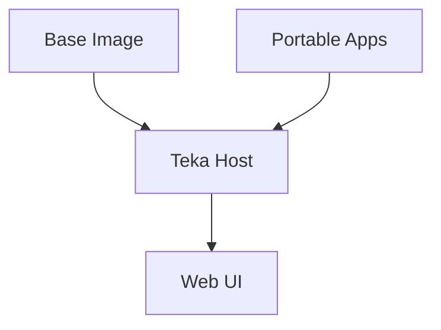

<div class="absolute top-8 left-10">
  
</div>

# Physical AI

Sensing & perception for robotics, infrastructure, and autonomy

<div class="pt-10 text-lg opacity-80">
  Built on Teka apps
</div>

<div class="pt-8">
  <span class="px-2 py-1 rounded cursor-pointer" hover="bg-white bg-opacity-10">
    Press Space for next slide
  </span>
</div>

---
layout: image-right
image: ./ouster/sensor-lineup.png
backgroundSize: contain
---

# Digital Lidar

Ouster's **all-semiconductor** architecture scales with Moore's Law:

- **OS0** — ultra-wide 90° FoV for robotics
- **OS1** — mid-range workhorse for security & AV
- **OSDome** — 180° hemispherical awareness
- **OS1 Max** — long-range flagship performance

<div class="text-sm opacity-75 mt-6">
Rev8 family — native color 3D vision for Physical AI
</div>

---
layout: two-cols
---

# Markets

<div class="text-sm opacity-90 mt-2">

**Industrial & robotics** — warehouse automation, AMRs, manipulation

**Smart infrastructure** — traffic analytics, security, BlueCity

**Automotive** — ADAS and autonomous programs

</div>

::right::

<div class="grid grid-cols-1 gap-3 mt-2">


</div>

---
layout: center
background: ./ouster/markets-hero.png
class: text-center
---

<div class="bg-black/55 rounded-2xl px-10 py-8 backdrop-blur-sm inline-block">

# Sense. Think. Act.

<div class="text-xl mt-4 opacity-90">
High-performance digital lidar + perception software
</div>

</div>

---
layout: image-right
image: ./ouster/sensor-os1.png
backgroundSize: contain
---

# What is Teka?

Immutable **NixOS appliance** platform for edge devices:

- Read-only root + **systemd-sysupdate** OTA
- Mutable state on **`/srv`**
- **Portable apps** as self-contained `.raw` images

::right::



<div class="text-sm opacity-80 mt-4">
Ship demos like this deck without rebaking the OS.
</div>

---
layout: default
---

# Example Apps

<div class="grid grid-cols-2 gap-4 mt-4 text-sm">

<div class="border border-white/20 rounded-lg p-4">

### Ouster & sensors
- **hello-ouster-terminal** — sensor viz (Wayland)
- **Platform sensors** — appliance telemetry

</div>

<div class="border border-white/20 rounded-lg p-4">

### Graphics & browser
- **hello-wayland-gpu** — Sway + Vulkan
- **hello-firefox** — Firefox on Wayland
- **hello-firefox-kiosk** — fullscreen kiosk

</div>

<div class="border border-white/20 rounded-lg p-4">

### Demos & AI
- **hello-pub** / **hello-sub** — pub/sub
- **hello-llm** — local LLM chat
- **hello-http** — Python HTTP

</div>

<div class="border border-white/20 rounded-lg p-4">

### This deck
- **hello-slidev** — you are here
- [Slidev](https://sli.dev) + Teka shell
- `/app/hello-slidev/static/deck/`

</div>

</div>

---
layout: center
class: text-center
---

# Fullscreen Deck

Static assets at `/app/hello-slidev/static/deck/`

<v-clicks>

- **Build** — `slidev build` in the Nix image
- **Serve** — staged under `web/deck/` in the app image
- **Present** — embedded shell at `/app/hello-slidev`

</v-clicks>

<div v-click class="mt-8 text-xl opacity-80">
Try <kbd class="px-2 py-1 rounded bg-white/10">f</kbd> for fullscreen presenter view
</div>

---
layout: default
---

# Build & Deploy

```bash
cd apps
nix build .#hello-slidev
```

```bash
teka app deploy --build hello-slidev --host http://HOST/
```

| Step | Command |
|------|---------|
| Open deck | `/app/hello-slidev` |
| Guest access | Toggle in toolbar when signed in |
| Direct URL | `/app/hello-slidev/static/deck/` |

---
layout: center
class: text-center
background: ./ouster/hero-physical-ai.png
---

<div class="bg-black/60 rounded-2xl px-12 py-10 backdrop-blur-sm inline-block">

# Thanks!

<div class="text-2xl mt-6 opacity-90">
Ouster sensing × Teka apps
</div>

<div class="mt-8 flex justify-center gap-6 text-sm opacity-70">
  <span>ouster.com</span>
  <span>·</span>
  <span>sli.dev</span>
</div>

</div>
