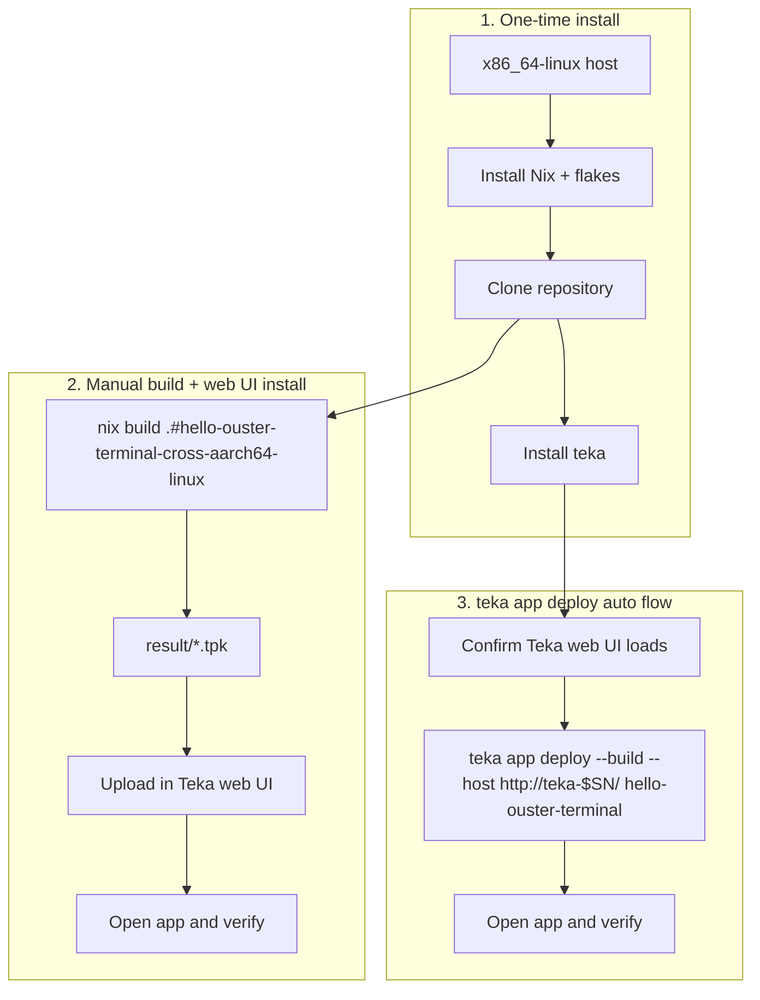

# Developer Guide

Task-oriented workflow for building app images from `apps/` and deploying them to a Teka device.

## Workflows



The first workflow is required once. Choose either manual web UI installation or the automated deploy command afterward.

## Workflow 1: One-time install

1. Complete the [Linux host setup](linux.md) and [Nix configuration](nix.md).
2. Clone this repository.
3. [Install the Teka CLI](../tools/teka/README.md#install) from the repository root.
4. Change to `apps/`, the directory containing `flake.nix`:

   ```bash
   cd teka-sdk/apps
   ```

5. List available app ids:

   ```bash
   teka app list
   ```

## Workflow 2: Manual build + web UI install

1. From `apps/`, build the app package targeting Jetson `aarch64-linux`:

   ```bash
   nix build .#hello-ouster-terminal-cross-aarch64-linux
   ```

2. In the web UI, upload the `.tpk` package from `result/`.
3. Open the app in the web UI and verify it.

Replace `hello-ouster-terminal` with another app id as needed.

## Workflow 3: `teka app deploy` auto flow

1. Open the Teka device web interface in a browser and confirm it loads.
2. Note the Teka administrator password set during initial setup.
3. From `apps/`, run:

   ```bash
   export TEKA_PASSWORD='…'
   teka app deploy --build --host http://zedbox-mini-nx-$SN.local/ hello-ouster-terminal
   ```

## Verify and iterate

After deploy:

- Open the device app UI or manager for the installed app.
- Read app-specific behavior and checks in the README in that app's directory under `apps/examples/`.
- Rerun the same `teka app deploy` command from `apps/` to rebuild and replace an existing install.

## Troubleshooting

| Symptom                                    | See                |
| ------------------------------------------ | ------------------ |
| Device unreachable or WSL networking issue | [wsl2.md](wsl2.md) |
| Flakes disabled, cache misses              | [nix.md](nix.md)   |
