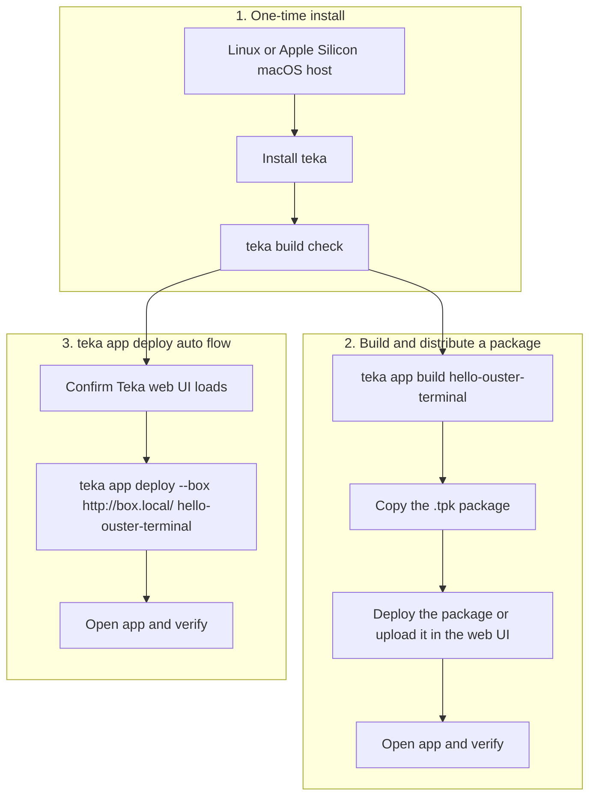

# Developer Guide

Build the examples in `apps/` from the repository root and deploy them to a Teka box.

## Workflows



The first workflow is required once. Then deploy from the project or build a package to distribute.

## Workflow 1: One-time install

1. Use a Linux x86_64/AArch64 or Apple Silicon macOS host. On Windows, complete the [WSL 2 setup](wsl2.md) first.
2. Install the latest teka release. See [Linux host setup](linux.md) for distribution packages.

   ```bash
   curl -fsSL https://raw.githubusercontent.com/ouster-lidar/teka-sdk/main/install.sh | sh
   ```

   The installer sets up the CLI and Nix if needed. On Arm Linux, the installer isn't available. From a checkout of this repository, run `./bootstrap.sh` instead. See the [CLI installation guide](../crates/teka-cli/README.md#install) for other options.
3. The build and deploy workflows below run from a checkout of this repository, in the folder that contains `flake.nix`. List available app ids:

   ```bash
   teka app list
   ```

## Workflow 2: Build and distribute a package

1. From the repository root, build for the box architecture. The default is `aarch64`, used by Jetson boxes. Use `--arch x86_64` for an x86_64 box.

   ```bash
   package=$(teka app build hello-ouster-terminal)
   ```

2. Copy the `.tpk` to any directory or machine. Upload it in the web UI or deploy it from the directory holding the copy. Package deployment only needs teka and access to the box.

   ```bash
   cp "$package" ./hello-ouster-terminal.tpk
   teka app deploy --box http://box.local/ ./hello-ouster-terminal.tpk
   ```

3. Open the app in the web UI and verify it.

Replace `hello-ouster-terminal` with another app id as needed.

## Workflow 3: `teka app deploy` auto flow

1. Open the Teka box web interface in a browser and confirm it loads.
2. From the repository root, select the box and deploy:

   ```bash
   teka box select http://teka-$SN.local/
   teka app deploy hello-ouster-terminal
   ```

Selection prompts for the box password and saves it in the OS credential store. Use `teka box select` without arguments to discover and select boxes interactively. For automation, supply `--box URL` and set `TEKA_PASSWORD`.

Use the box's actual hostname or IP address. teka selects each box's architecture, uploads the package from the Nix store, and checks startup logs. Nix downloads available outputs from its configured caches and builds on a cache miss. A temporary out-link protects the packages from garbage collection during deployment. Set `TEKA_BOX` or pass `--box` to override the saved selection. Repeat `--box` to deploy to several boxes.

## Create a standalone app

List the starter examples (hello-world, hello-webui, and hello-ouster-world), then initialize a project from one:

```sh
teka app list --examples
teka app init --example hello-world my-app
cd my-app
teka app deploy --box http://box.local/
```

Initialization pins the SDK revision and stages the generated files in Git without committing them.
It preserves the example's app ID; `my-app` names the project directory.
App names can be omitted when the project contains exactly one app.

## Verify and iterate

After deploy:

- Open the box app UI or manager for the installed app.
- Read app-specific behavior and checks in the README in that app's directory under `apps/examples/`.
- Rerun the same `teka app deploy` command from the repository root to rebuild and replace an existing install.

## Troubleshooting

| Symptom                                    | See                |
| ------------------------------------------ | ------------------ |
| Box unreachable or WSL networking issue | [wsl2.md](wsl2.md) |
| Flakes disabled, cache misses              | [nix.md](nix.md)   |
