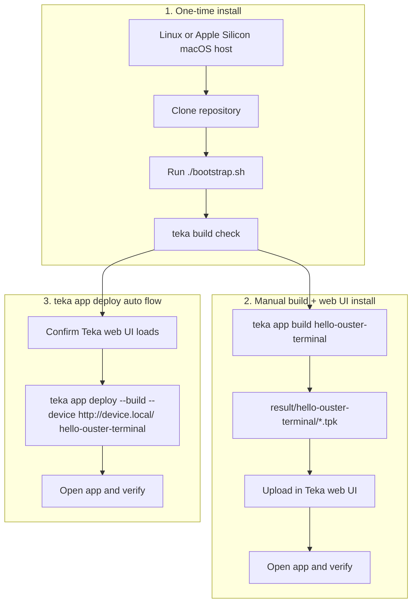

# Developer Guide

Build the examples in `apps/` from the repository root and deploy them to a Teka device.

## Workflows



The first workflow is required once. Choose either manual web UI installation or the automated deploy command afterward.

## Workflow 1: One-time install

1. Use a Linux x86_64/AArch64 or Apple Silicon macOS host. On Windows, complete the [WSL 2 setup](wsl2.md) first.
2. Clone this repository. See [Linux host setup](linux.md) for distribution packages.
3. Run `./bootstrap.sh` from the repository root. See the [CLI installation guide](../crates/teka-cli/README.md#install) for alternatives and macOS builder setup.
4. Run commands from the repository root, which contains `flake.nix`:

   ```bash
   cd teka-sdk
   ```

5. List available app ids:

   ```bash
   teka app list
   ```

## Workflow 2: Manual build + web UI install

1. From the repository root, build the app package targeting Jetson `aarch64-linux`:

   ```bash
   teka app build --arch aarch64 hello-ouster-terminal
   ```

2. In the web UI, upload the `.tpk` package from `result/hello-ouster-terminal/`.
3. Open the app in the web UI and verify it.

Replace `hello-ouster-terminal` with another app id as needed.

## Workflow 3: `teka app deploy` auto flow

1. Open the Teka device web interface in a browser and confirm it loads.
2. From the repository root, select the device and deploy:

   ```bash
   teka device select http://teka-$SN.local/
   teka app deploy --build hello-ouster-terminal
   ```

Selection prompts for the device password and saves it in the OS credential store. Use `teka device select` without arguments to discover and select devices interactively. For automation, supply `--device URL` and set `TEKA_PASSWORD`.

Use the device's actual hostname or IP address.
`--build` selects its architecture, builds the package, uploads it, and checks startup logs.
You can set `TEKA_DEVICE` instead of passing `--device`, or repeat `--device` to deploy to several devices.

## Create a standalone app

List examples, then initialize a project from one:

```sh
teka app list --examples
teka app init --example hello-world my-app
cd my-app
teka app build
teka app deploy --build --device http://device.local/
```

Initialization pins the SDK revision and stages the generated files in Git without committing them.
It preserves the example's app ID; `my-app` names the project directory.
App names can be omitted when the project contains exactly one app.

## Verify and iterate

After deploy:

- Open the device app UI or manager for the installed app.
- Read app-specific behavior and checks in the README in that app's directory under `apps/examples/`.
- Rerun the same `teka app deploy` command from the repository root to rebuild and replace an existing install.

## Troubleshooting

| Symptom                                    | See                |
| ------------------------------------------ | ------------------ |
| Device unreachable or WSL networking issue | [wsl2.md](wsl2.md) |
| Flakes disabled, cache misses              | [nix.md](nix.md)   |
