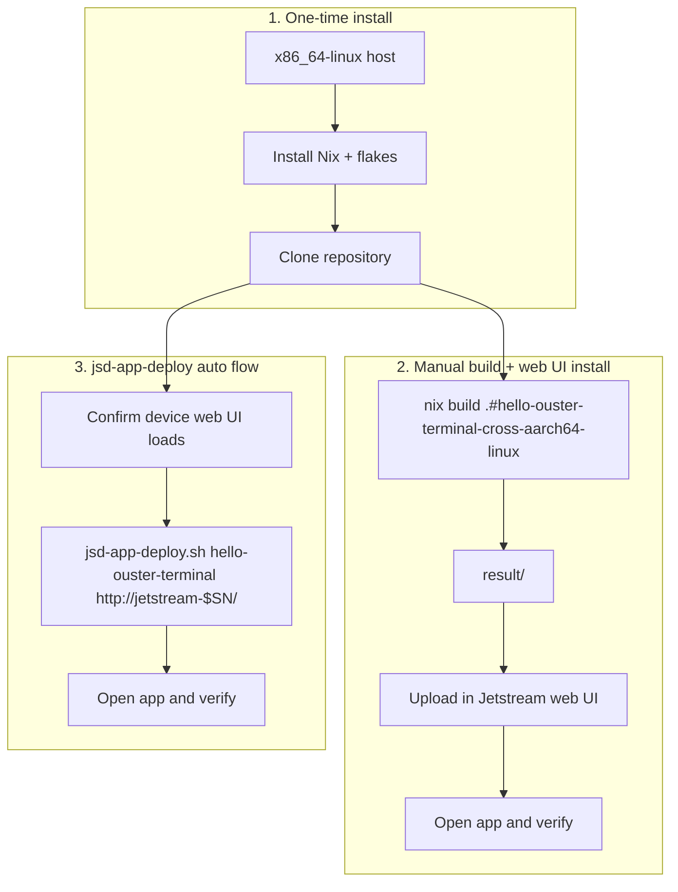

# Developer Guide

Task-oriented workflow for building app images from `apps/` and deploying them to a Jetstream device.

## Workflows



The first workflow is required once. Choose either manual web UI installation or the automated deploy script afterward.

## Workflow 1: One-time install

1. Complete the [Linux host setup](linux.md) and [Nix configuration](nix.md).
2. Clone the repository:

   ```bash
   git clone https://gitlab.com/ouster-jetstream/jetstream-example-apps.git
   ```

3. Change to `apps/`, the directory containing `flake.nix`:

   ```bash
   cd jetstream-example-apps/apps
   ```

4. List available app ids:

   ```bash
   ./scripts/jsd-app-deploy.sh --help
   ```

## Workflow 2: Manual build + web UI install

1. From `apps/`, build the app image targeting Jetson `aarch64-linux`:

   ```bash
   nix build .#hello-ouster-terminal-cross-aarch64-linux
   ```

2. In the Jetstream web UI, upload the image from `result/`.
3. Open the app in the web UI and verify it.

Replace `hello-ouster-terminal` with another app id as needed.

## Workflow 3: `jsd-app-deploy` auto flow

1. Open the Jetstream device web interface in a browser and confirm it loads.
2. Note the Jetstream administrator password set during initial setup.
3. From `apps/`, run:

   ```bash
   export JETSTREAM_MC_PASSWORD='…'
   ./scripts/jsd-app-deploy.sh hello-ouster-terminal http://zedbox-mini-nx-$SN.local/
   ```

## Verify and iterate

After deploy:

- Open the device app UI or manager for the installed app.
- Read app-specific behavior and checks in each app's README or `*.md` under `apps/examples/`.
- Rerun the same `./scripts/jsd-app-deploy.sh` command from `apps/` to rebuild and replace an existing install.

## Troubleshooting

| Symptom                                    | See                |
| ------------------------------------------ | ------------------ |
| Device unreachable or WSL networking issue | [wsl2.md](wsl2.md) |
| Flakes disabled, cache misses              | [nix.md](nix.md)   |
